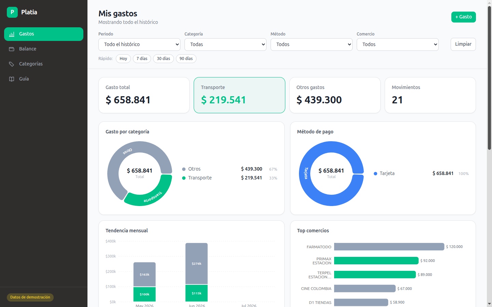
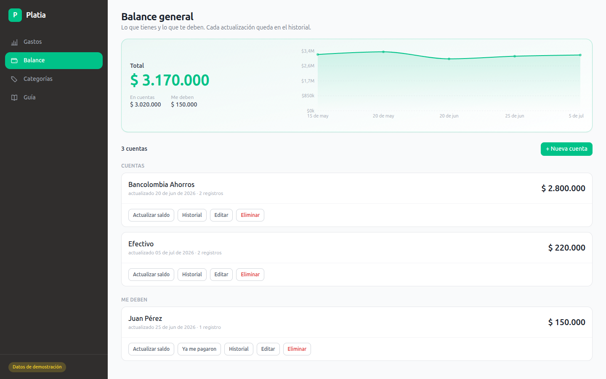

# Platia

[](https://github.com/Danieldlr13/Platia/actions/workflows/ci.yml)

Platia convierte los correos de notificación de Bancolombia en un panel de gastos:
un ingestor lee el buzón por IMAP, extrae monto, comercio y fecha, clasifica cada
movimiento (Transporte u otras categorías del usuario) y lo guarda en Supabase.
Evita registrar los gastos a mano y permite ver cuánto se gasta en transporte
frente al resto.

- **Stack:** TypeScript, Next.js 15 (App Router) y React 19, Tailwind, Recharts,
  Supabase (Postgres, Auth y RLS), IMAP con `imapflow` y `mailparser`, Vitest,
  GitHub Actions y Vercel.
- **Demo:** el despliegue en <https://platia-nu.vercel.app> requiere iniciar sesión.
  Para explorarlo sin cuenta, `npm run dev` sin variables de Supabase arranca el panel
  con datos de demostración generados (`src/lib/demo-data.ts`).
- **Pruebas:** `npm ci && npm test` (Vitest, sin red ni credenciales). El parser
  se prueba con correos sintéticos.

> **Estado:** proyecto en pausa. El cron de ingesta (`.github/workflows/ingest.yml`)
> está desactivado, así que el despliegue no recibe correos nuevos.

## Capturas

Con datos de demostración, no reales.





## Cómo funciona

```
Bancolombia → correo del usuario → [filtro Gmail reenvía] → buzón dedicado
   → cron (GitHub Actions) lee por IMAP → parser → clasificador → Supabase
   → panel web (Next.js)
```

Más detalle: [`docs/arquitectura.md`](docs/arquitectura.md) (diagramas Mermaid).
Los diseños fechados en `docs/superpowers/specs/` son históricos.

## Qué incluye

- Parser de correos de Bancolombia y de recibos de Uber, con pruebas.
- Clasificador por reglas de comercio (Transporte / Otros) y categorías
  administrables por el usuario.
- Ingestor idempotente: deduplica por `Message-ID` con `upsert` en
  `(user_id, email_message_id)`.
- Panel con filtros, agrupaciones y gráficos; edición de categoría y borrado de
  movimientos.
- Balance general: cuentas y "me deben", con historial de saldos editable.
- Login con Supabase Auth y aislamiento por usuario con RLS (`db/schema.sql`).

Limitación conocida: el ingestor atribuye todos los correos al usuario definido en
`CUENTAS_USER_ID`; el ruteo correo → usuario no está implementado.

## Estructura

| Ruta | Qué es |
|---|---|
| `src/lib/parser.ts`, `src/lib/parser-uber.ts` | Extraen monto, comercio, fecha y tarjeta del correo |
| `src/lib/classifier.ts` | Reglas comercio → categoría |
| `src/lib/agregaciones.ts` | Totales por mes y categoría para el panel |
| `src/ingest/ingest.ts` | Lee el buzón por IMAP y guarda en Supabase |
| `src/ingest/log-seguro.ts` | Describe errores sin volcar datos del usuario |
| `db/schema.sql`, `db/seed.sql` | Base de datos y datos iniciales |
| `app/(app)/`, `src/components/` | Panel web: Gastos, Balance, Categorías, Guía |
| `middleware.ts`, `app/login/` | Login y protección de rutas |
| `scripts/` | Utilidades locales de migración y diagnóstico (solo imprimen conteos) |
| `test/` | Pruebas de Vitest |

## Desarrollo local

```bash
npm ci
npm test              # pruebas (Vitest)
npm run typecheck     # tsc --noEmit
npm run build         # build de Next.js
npm run dev           # panel en http://localhost:3000 (datos demo sin Supabase)
```

`npm run ingest:eml` valida el parser contra archivos `.eml` reales que pongas en
la raíz del proyecto (están en `.gitignore`) e imprime solo conteos.

El repo no define ESLint, por eso el CI no ejecuta `lint`.

## Puesta en marcha (producción)

1. **Buzón de ingesta:** en una cuenta de Gmail dedicada, activar la verificación
   en dos pasos y generar una **contraseña de aplicación**.
2. **Reenvío:** en el Gmail personal, crear un filtro *De:*
   `notificacionesbancolombia.com` → **Reenviar a** la dirección del buzón de
   ingesta. Para el histórico, reenviar los correos antiguos en lote.
3. **Supabase:** crear el proyecto, ejecutar `db/schema.sql`, crear el usuario en
   *Authentication → Users*, poner su correo en `db/seed.sql` y ejecutarlo.
4. **Variables:** copiar `.env.example` a `.env` y completarlo.
5. **Cron:** cargar los mismos valores como *Secrets* de GitHub Actions. El
   workflow corre cada 15 minutos mientras esté activo.
6. **Web:** desplegar en Vercel con `NEXT_PUBLIC_SUPABASE_URL`,
   `NEXT_PUBLIC_SUPABASE_ANON_KEY`, `SUPABASE_URL`, `SUPABASE_SERVICE_ROLE_KEY` y
   `CUENTAS_USER_ID`.

Los scripts de migración (`npm run migrar:adjuntos`, `npm run migrar:uber`) y
`scripts/inspeccionar-adjuntos.ts` leen además `MIGRACION_REMITENTE`: la dirección
del correo desde el que se enviaron los `.eml` adjuntos.
